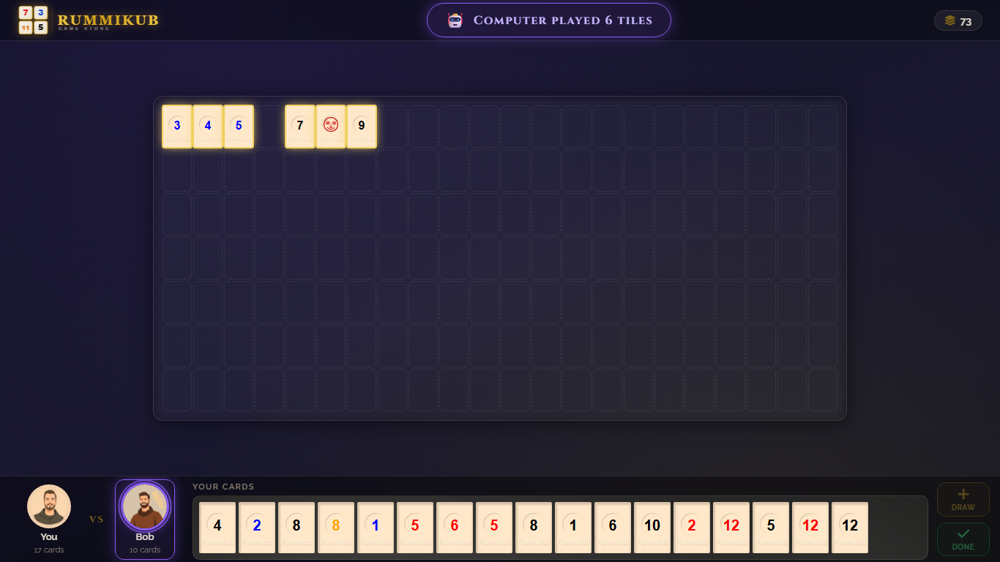

# Rummikub — Player vs Computer

A browser version of **Rummikub**: one human player against a computer opponent ("Bob").
Written in plain JavaScript, HTML and CSS — no frameworks, no build step, no server-side code.
The computer's decision logic (`js/ai.js`) is an original matrix-based algorithm.



## Run it

The game is loaded as ES modules, so it needs a local web server (opening the HTML file
directly with `file://` does not work). Any static server is fine, for example:

```bash
python -m http.server 8000
```

Then open <http://localhost:8000>. It starts at the sign-in page; sign up with any name
(accounts are stored only in your browser), then pick Rummikub. To go straight to the game,
open <http://localhost:8000/html/game.html>.

Other options: `npx serve .` or the Live Server extension in VS Code.
After changing code, reload with **Ctrl+F5** so the browser does not use old cached files.

### Test modes

Add these to the game URL (they can be combined: `game.html?smallDeck&jokers`):

| Parameter    | Effect                                                    |
|--------------|-----------------------------------------------------------|
| `?smallDeck` | The deck starts with only 5 tiles, to reach the end fast. |
| `?jokers`    | You get both jokers at the start.                         |

## How to play

- **Tiles:** 106 — numbers 1–13 in four colors (red, blue, black, orange), two of each, plus 2 jokers.
  Each player starts with 14 tiles.
- **Sets** (at least 3 tiles):
  - **Run:** consecutive numbers of one color, placed left to right in increasing order (e.g. 4-5-6 red). 1 does not follow 13.
  - **Group:** the same number in 3 or 4 different colors.
  - **Joker:** stands for any tile and is worth the tile it replaces.
- **Your turn:** drag tiles from your tray to the board and press **Done**, or press **Draw** to take a tile.
  - **First meld:** at least 30 points, only from your own tiles, without touching the board.
  - After that you may add to, split and rearrange any sets on the board, as long as every set is valid
    at the end of the turn. Tiles that were on the board never go back to your tray.
  - A joker can be taken from the board by putting the tile it stands for in its place, and using the joker in another set in the same turn.
- **Winning:** the first player to empty their tray wins. If the deck runs out and nobody can play,
  the lower total in hand wins (a joker in hand counts 30).

If a move breaks a rule, the game explains why and offers **Try Again** (undo the move) or **Take a Card**.

## Project structure

```
index.html            redirects to the sign-in page
html/                 pages: sign-in (contat.html), home, game, instructions, win/fail
css/                  one stylesheet per page
js/
  tiles.js            deck, jokers, shuffle, draw                 ┐
  rules.js            groups, runs, jokers, board validation      │ game logic — no DOM,
  ai.js               the computer's algorithm                    │ importable from Node
  game-logic.js       game state and turn rules                   ┘
  game-main.js        entry point: wiring, computer turn display  ┐
  game-render.js      drawing tiles, board and tray               │ user interface
  game-board.js       board grid, drag and drop                   │
  game-ui.js          turn banner, counters, message box          ┘
tests/
  *.test.js           unit tests (node:test)
  helpers.js          short tile notation for tests: R5 K5 B5 O5, J / j = jokers
  playtest.js         playtest bot (see below)
images/               avatars, logo, joker faces
```

The game logic is kept separate from the DOM so it can be tested in Node without a browser.
The whole game state is one object created by `createGame()` in `js/game-logic.js`.

## Tests and the playtest bot

Requires [Node.js](https://nodejs.org) 22 or newer. Nothing to install — only Node's built-in test runner.

```bash
npm test                                         # unit tests: node --test "tests/**/*.test.js"
npm run playtest                                 # 500 full games with the playtest bot
node tests/playtest.js --games 2000 --seed 1     # more games
node tests/playtest.js --games 1 --seed 37 --verbose   # replay one game
```

The **playtest bot** plays complete games without a browser: a simple bot takes the human's place
against the real computer AI. After every turn it checks invariants:

- all 106 tiles exist exactly once (hands + board + deck);
- every set on the board is valid — checked by an independent brute-force checker, not by `rules.js`;
- the first meld is worth 30+ and does not touch the board;
- tiles on the board stay on the board, and hands only gain drawn tiles;
- the turn really passes, and the AI answers quickly (each game runs in a worker thread, so an infinite loop is reported instead of hanging);
- a game that ends with an empty deck is won by the lower hand.

Every game uses a seed, so any problem it reports can be replayed exactly. The exit code is 1
if any problem was found, 0 otherwise.
